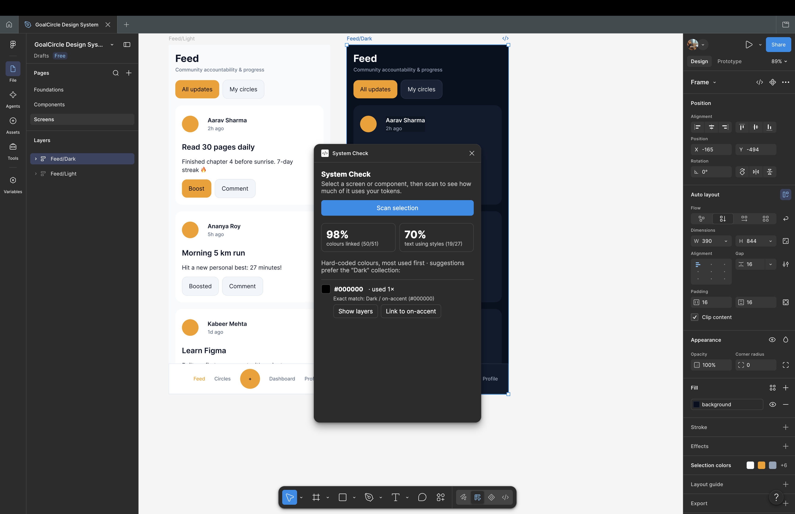
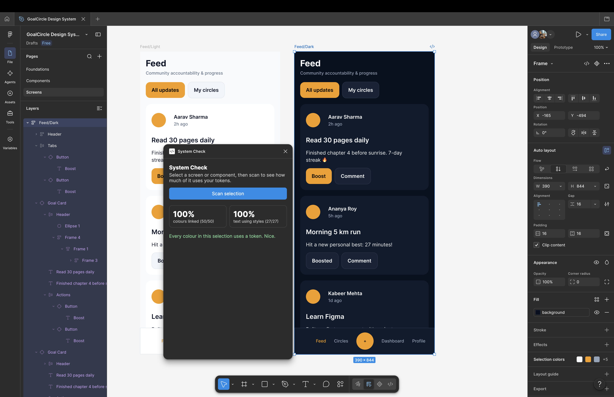
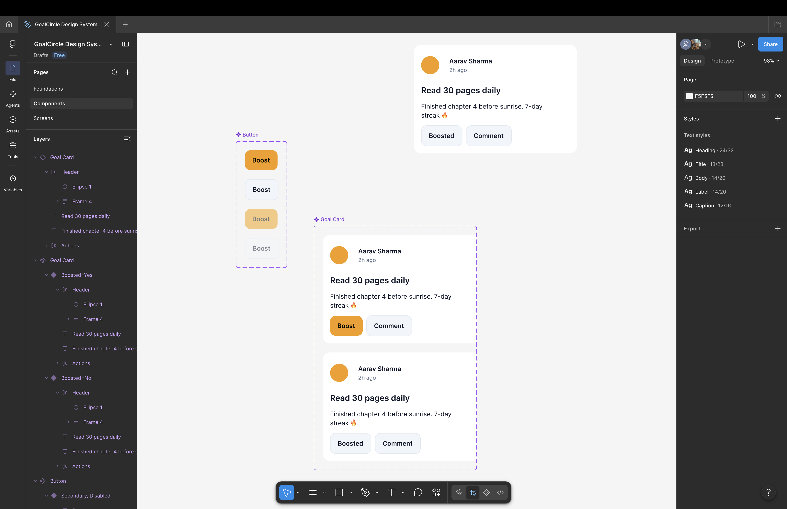
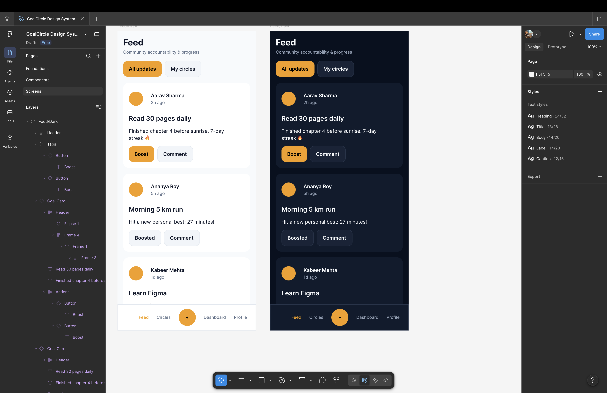

# System Check: a Figma plugin for design-system adoption

System Check tells you how much of a screen actually uses your design system. Select a frame and press **Scan**. It shows:

- **% of colours linked to tokens:** fills and strokes bound to a colour variable or colour style.
- **% of text using text styles.**
- **Every hard-coded colour,** most used first, with the closest matching token. **Show layers** jumps to where it's used, and **Link to …** swaps it for the token in one click.

## Screenshots

**Before and after on my own dark Feed screen:** 98% / 70% became 100% / 100%.

| Before | After |
| --- | --- |
|  |  |

**The design system it checks:** Button and Goal card components with variants, built on light and dark colour tokens.

**The Feed screen in light and dark,** built only from those components and re-themed by swapping six tokens.

## Why I built it

While building GoalCircle's design system, I made a dark version of the Feed screen by swapping six colour tokens. Almost everything switched, except for white boxes behind every user's name. A nested frame had a hard-coded `#FFFFFF` fill instead of a token. It was invisible in light mode and only showed up when I re-themed the screen.

Design-system teams have this problem at scale: they can't easily see where people bypass the system. System Check makes it measurable (an adoption %) and fixable (one-click linking).

## Install (Figma desktop app, free plan is fine)

1. Download and unzip this folder.
2. Open the **Figma desktop app**. Development plugins can't be imported in the browser version.
3. Open your file, then go to **Menu → Plugins → Development → Import plugin from manifest…** and choose `manifest.json` from this folder.
4. Run it from **Plugins → Development → System Check**.

## How it works (plain English)

1. **Collect the tokens:** it reads every colour variable in the file and notes its colour and collection (for example "Light" or "Dark").
2. **Walk the layers:** it visits the selected frame and every layer inside it, skipping hidden ones.
3. **Check each colour:** for every solid fill and stroke, it asks whether this colour is linked to a variable or style. If yes, it counts as linked. If no, it records the hex value and the layer.
4. **Check each text layer:** does it use a text style?
5. **Suggest a token:** for each hard-coded colour, it finds the variable with the closest colour. If two are equally close, it prefers the collection the screen already uses most, so a dark screen gets "Dark" suggestions first.
6. **Fix:** "Link to …" replaces the hard-coded colour with the variable on those layers, then re-scans so the score updates.

It never sends data anywhere: no network access is enabled.

## What happened on my own file

First scan of my GoalCircle dark Feed screen: **98% of colours linked, 70% of text using styles.** The one hard-coded colour was a stray fill behind each user's name. The plugin's suggestion, the closest token, was technically correct but wrong in context: the right fix was to delete the fill, not link it. That's why the plugin shows the layers first and lets a person decide instead of auto-fixing. It's the same human-in-the-loop idea as my EvidenceLens project.

## Known limitations (deliberate scope for v1)

- **The closest colour isn't always the right token.** A white fill on a dark screen matches *Light / surface* exactly, but the right fix might be to remove the fill. That's why **Show layers** comes before **Link**: a person decides.
- **Only solid colours are checked.** Gradients, images, effects, spacing and corner radius aren't, yet. Spacing and radius variables are the obvious next step.
- **It doesn't detect detached components.**
- **Next idea:** an AI summary that turns the scan into a short note for the design-system team ("Feed screen is 92% on-system; the main gap is hard-coded whites in the card header").

## Built with

I designed the product, the scoring rules and the edge cases; the code was written with an AI coding assistant (Claude) to my spec. I tested it on my own GoalCircle design file.
